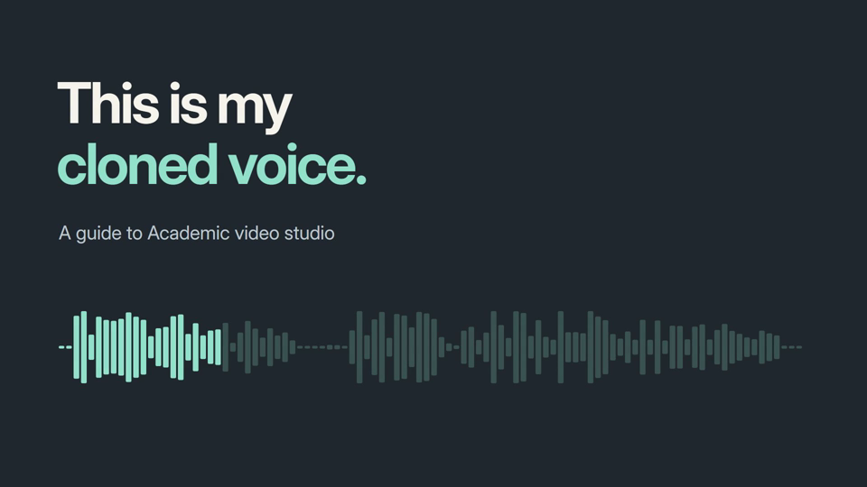

# Academic video studio

Turn lecture notes, papers and other source material into reusable videos with your own cloned voice narration. **You are the academic director. Codex does the production.**

Use it for course introductions, prerequisite explanations, research summaries, methods walkthroughs or any stable information that benefits from being recorded once. Direct the work in ordinary language: change the argument, fix a pronunciation, simplify a diagram or ask for a different visual style.

**[Watch the guide — 90 seconds, with sound](docs/starter-demo.mp4)** · [Subtitles](docs/starter-demo.srt)

## Start here

1. Create a new, empty folder on your device, for example **My academic videos**, and open it as a project in Codex. Ask: **“Please download the starter files from https://github.com/leemager/academic-video-studio into this folder. Once they're ready, show me STARTER-PROMPT.txt.”** You don't need GitHub or command-line experience; Codex can bring in the files for you.
2. Once Codex has downloaded the files, copy and paste the contents of [STARTER-PROMPT.txt](STARTER-PROMPT.txt) into your chat. Codex will inspect your computer, set up the local tools and open the starter example.
3. Provide a clean **MP3 recording of your own voice, around 15 seconds long**. Codex will transcribe it automatically, show you the words for a quick check, then create your voice profile and give you a short sample to hear.
4. Add your lecture notes, papers or other sources under `notes/`, then describe what you want.

You do not need to learn video editing, Python or Remotion. The setup scripts and technical guides are for Codex to use on your behalf. You may need to click through an installer or microphone prompt.

After setup, try:

> I've added lecture notes and relevant papers in notes/my-topic. Please draft an outline for a five-minute introduction for first-year students, using my cloned voice. Show me the outline and script before producing it. Explain the central idea with one concrete example and leave a question for the seminar.

Or:

> Use the materials in notes/my-paper to propose a three-minute research explainer for an interdisciplinary audience. Keep the findings distinct from their limitations, and show me the source of each important claim.

## What is included

- Windows, macOS and Linux setup entry points, hardware checks and measured voice benchmarks.
- A [VoiceStudio guide](docs/VOICESTUDIO.md), plus a scripted local OmniVoice renderer for repeatable production.
- Voice setup and a simple browser page for comparing alternative readings.
- Production, voice and Remotion skills that travel with the repository.
- Transcript checks, captions, reusable scene layouts and MP4 exports.
- The **StarterDemo** guide above, narrated in Lee Mager's cloned voice, including three language examples.

Your personal voice files, notes and videos stay in your working folder and are excluded from Git uploads by default. See [sharing and backups](docs/SHARING.md) when you want to share or move your work.

## Computer expectations

| Computer | Video preview/render | New cloned narration |
| --- | --- | --- |
| Windows x64 | Supported setup | NVIDIA CUDA or slower CPU |
| Apple Silicon Mac | Supported setup | Integrated GPU via MPS; CPU fallback |
| Linux x64 | Supported setup; browser libraries may be needed | NVIDIA CUDA or slower CPU |
| Intel Mac | Preview/render and imported audio | Current pinned voice stack unsupported |
| Windows/Linux ARM or other accelerators | Ask Codex to check compatibility | Depends on the hardware and available engine |

A powerful graphics card is helpful but not essential on supported computers. Smaller laptops will take longer. Allow at least 15 GB of free space for setup, plus room for your videos. Codex will test a short passage to estimate how long production will take on your machine.

## Guides

- [First-time setup](docs/SETUP.md) · [Your voice](docs/VOICE.md) · [VoiceStudio](docs/VOICESTUDIO.md)
- [Everyday direction and example prompts](docs/DIRECTING.md) · [Production commands](docs/PRODUCTION.md)
- [Troubleshooting](docs/TROUBLESHOOTING.md) · [Sharing and private backups](docs/SHARING.md)
- [Software/model terms](THIRD-PARTY-NOTICES.md) · [Asset credits](ASSET-CREDITS.md)

Use your institution's guidance when choosing material to share with Codex. Read the [notices](THIRD-PARTY-NOTICES.md) for permitted uses of the software and voice models.
